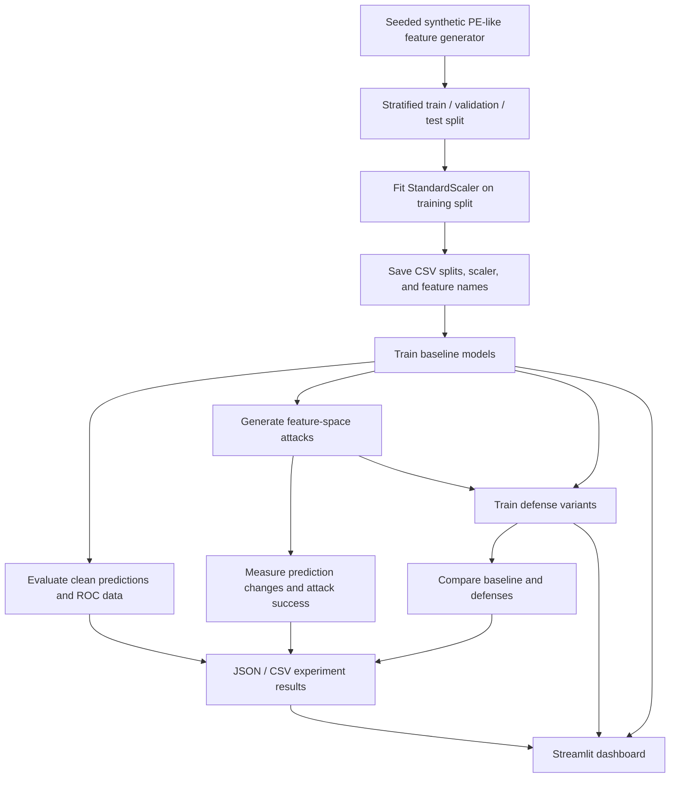

# MalwareShield AI

MalwareShield AI is an educational malware-classification and adversarial-robustness workbench. It combines a reproducible feature-based ML pipeline with a Streamlit dashboard for examining predictions, attack simulations, defenses, and evaluation metrics.

> **Scope:** This repository currently uses a generated synthetic dataset that resembles groups of PE-derived features. It does not extract features from executable files, scan binaries, or modify PE files. The attacks are simulated on feature vectors only. An EMBER archive downloaded separately is not automatically loaded by this project.

## Problem Being Addressed

Malware classifiers can make incorrect predictions when input features are perturbed, even when the changes are small. This project provides a practical way to explore that robustness problem by:

- Training multiple classical classifiers on the same feature dataset.
- Applying several feature-space perturbation strategies to model inputs.
- Comparing baseline classifiers with defensive training, input validation, and an ensemble.
- Presenting model metrics and experiment outputs through an interactive dashboard.

This is a research and teaching demonstration, not production endpoint protection or a validated benchmark of real malware.

## Project Contribution and Novelty

The project contribution is an integrated, inspectable workflow that puts baseline training, adversarial attack simulations, defenses, and metric visualization in one application. It lets a user compare different model families and robustness strategies using a shared dataset and experiment pipeline.

The attacks and classifiers are established methods rather than newly proposed algorithms. The project should therefore be understood as an educational integration and comparison platform, not as a claim of a novel malware-detection algorithm.

## Models and Methods

### Machine-learning models

- **Random Forest:** Tree-ensemble baseline; also used as the adversarial-training model and within the soft-voting ensemble.
- **Gradient Boosting:** Boosted decision trees used as a baseline and ensemble member.
- **Logistic Regression:** Linear baseline and differentiable surrogate used to guide FGSM and PGD perturbations.

### Deep-learning models

No deep-learning models are currently implemented. The models are Scikit-learn classical ML estimators; XGBoost appears in the dependency list but is not part of the current training pipeline.

### Attack simulations

- **FGSM:** Uses the Logistic Regression surrogate's coefficient signs to perturb mutable features.
- **PGD:** Iteratively applies surrogate-guided steps and projects perturbations back into an epsilon-bounded region.
- **Genetic Algorithm:** Searches candidate feature vectors using mutation, crossover, and model output as a fitness signal; it does not require gradients.
- **Random perturbation:** Adds bounded random changes as a non-directed control.

The implementation limits perturbations to configured mutable feature indices (20-49) and constrains per-feature changes by epsilon. These operations affect model inputs only; they do not produce executable files.

### Defenses

- **Adversarial training:** Augments the training set with PGD-style adversarial feature examples, then trains a Random Forest on the augmented set.
- **Input validation:** Learns per-feature bounds from training data, clips out-of-bound inputs, and exposes an anomaly score.
- **Soft-voting ensemble:** Combines Random Forest, Gradient Boosting, and Logistic Regression probabilities.

## Architecture



### Main components

- `app.py`: Streamlit entry point and navigation.
- `config.py`: Dataset paths, feature groups, model hyperparameters, and attack/defense settings.
- `src/preprocessing.py`: Synthetic feature generation, stratified splitting, scaling, and artifact output.
- `src/train.py`: Baseline model training, metric computation, and model persistence.
- `src/attacks.py`: FGSM, PGD, genetic, and random feature-space attack routines.
- `src/defense.py`: Adversarial training, input validation, and ensemble defense.
- `src/evaluation.py` and `src/visualization.py`: Evaluation and visualization helpers.
- `experiments/run_experiments.py`: End-to-end experiment runner.
- `src/ember.py` and `experiments/run_ember.py`: EMBER JSONL to labeled CSV conversion.
- `dashboard/`: Overview, detection, attack, defense, evaluation, and research pages.

## Dataset and Features

The default dataset is generated by `src/preprocessing.py` using a fixed random seed. Its default configuration creates 10,000 rows, 50 numeric features, and a 40% malicious label share. The features are organized into PE-header-like, section-statistics, import/export, entropy, string, and miscellaneous groups. The binary label is `0` for benign and `1` for malicious.

The generated values are illustrative; they are not extracted from actual PE files. The current pipeline fits `StandardScaler` on the training data and applies that scaler to validation and test splits. Generated artifacts are written under `data/processed/` and `data/sample/`.

### Using EMBER

The repository includes a data-only converter for the extracted EMBER 2017 JSONL feature release. It maps raw feature groups to the fixed 2,351-dimensional numeric representation, skips unlabeled rows (`label = -1`), and makes balanced labeled train/test CSV subsets. It does not train models, add an EMBER dashboard page, or change the synthetic dataset and app. The converter reads files incrementally and stops after collecting the requested class counts, subject to a configurable scan limit.

Extract the archive so the JSONL files are in the `ember/` directory, then run:

```powershell
python experiments/run_ember.py --samples-per-class 100
```

This creates only `data/ember/train.csv` and `data/ember/test.csv`. Each CSV contains the requested number of benign and malicious rows (200 rows by default), 2,351 feature columns, and a `label` column. Increase `--samples-per-class` to extract a larger sample. `--max-records` controls the maximum records scanned per split (default 250,000). These files are a standalone dataset for experiments and are not directly compatible with the app's existing 50-feature synthetic models.

## Installation and Running

Use Python 3.11 (or a compatible Python version supported by the installed dependencies) from the project root.

```powershell
python -m venv .venv
.\.venv\Scripts\Activate.ps1
python -m pip install --upgrade pip
python -m pip install -r requirements.txt
```

Run the dashboard:

```powershell
python -m streamlit run app.py
```

Run the end-to-end experiment pipeline:

```powershell
python experiments/run_experiments.py
```

The experiment runner creates missing dataset splits and baseline/defense models, runs attacks and evaluations, and writes outputs to `experiments/results/`. Existing generated splits or saved models may be reused. To regenerate from scratch, remove only the generated dataset/model/result artifacts you intend to replace, then rerun the pipeline.

Run tests:

```powershell
python -m pytest -q
```

## Dashboard Pages

- **Overview:** Dataset and model summary.
- **Malware Detection:** Try the provided sample data, upload feature rows, or enter feature values for predictions.
- **Adversarial Attack Lab:** Configure and inspect feature-space attack experiments.
- **Defense Laboratory:** Explore the available defense models.
- **Model Evaluation:** Review evaluation metrics and comparisons.
- **Research & Docs:** Project background and supporting information.

Prediction inputs must follow the feature names and order expected by the saved model. Use `data/sample/sample_features.csv` as the local example format.

## Metrics and Interpretation

The synthetic pipeline writes results under `experiments/results/`. Its current baseline metrics report 1.0 accuracy, precision, recall, F1, and ROC-AUC for all three models. Those values reflect the generated synthetic data's strong class separation and are **not evidence of equivalent performance on real malware**. The EMBER converter only prepares data; it does not train or evaluate models.

For meaningful real-world evaluation, use a sufficiently large, documented benchmark sample, preserve its train/test protocol, and report dataset version, label handling, and preprocessing. Do not compare EMBER metrics directly with synthetic dataset metrics.

## Repository Layout

```text
dashboard/              Streamlit dashboard pages
data/                   Synthetic generated splits and demo samples
experiments/             Experiment runner and saved results
models/baseline/         Trained baseline estimators
models/defended/         Trained defense estimators
src/                     Data, training, attack, defense, and evaluation logic
tests/                   Pytest test suite
app.py                   Streamlit application entry point
config.py                Shared project configuration
requirements.txt         Python dependencies
```

## Safety and Limitations

- Treat this as a research/education prototype, not an operational malware scanner.
- Do not run unknown executable samples as part of this feature-vector workflow.
- Adversarial examples are arrays of modified values, not valid or modified malware binaries.
- The synthetic dataset is unsuitable for claims about real-world detection quality.
- EMBER preprocessing converts the extracted 2017 JSONL feature release to standalone CSVs; raw PE feature extraction, EMBER model training, deep-learning models, and production deployment are outside the current implementation.
